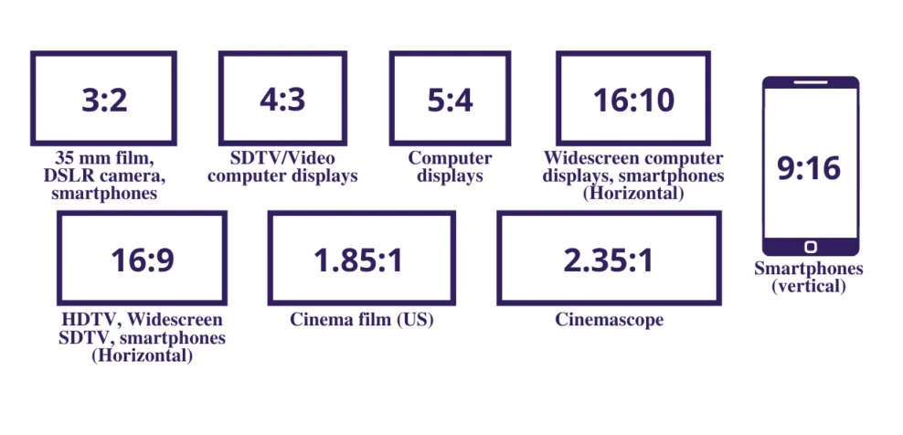
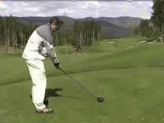
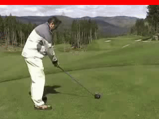
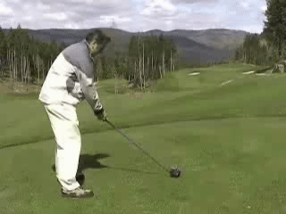
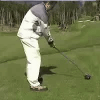
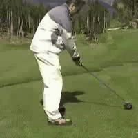
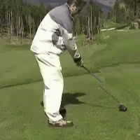
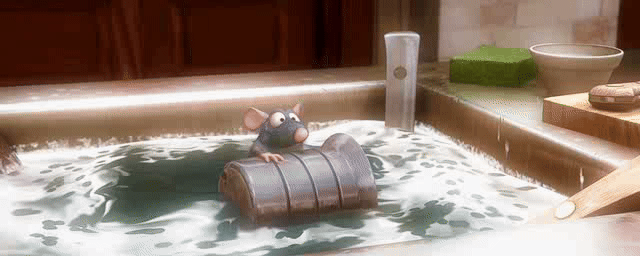
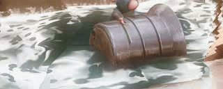

# Video Retargeting - Content-Aware Video Resizing


## Table of Contents

- [Video Retargeting](#video-retargeting)
  - [Table of Contents](#table-of-contents)
  - [Introduction](#introduction)
  - [Demo](#demo)
  - [File Structure](#file-structure)
  - [Experiments and Results](#experiments-and-results)
  - [Getting started](#Getting-Started)
  - [Future Goals](#future-goals)
  - [References](#references)
  - [License](#license)

## Introduction

Video retargeting is the process of automatically adapting a video to fit a display with a different aspect ratio or resolution. For example, if we have a source video of size `1024×1024` and want to display it on a mobile with display of size `512×256`, we need to resize the video to `512×256`. 

<p align="center">
  
  <br>
  <small><i>Image source: http://unisystem.com/uni-abc/lcd-screen-resolutions-and-aspect-ratios-key-parameters-and-applications</i></small>
</p>

Seam carving is an algorithm that resizes images by preserving the most important content. For example, in an image with a monument, seam carving will try to keep the monument intact while removing pixels from less important areas, such as the background, in a way that minimizes visual distortion. This idea of seam carving can be extended to videos. Improved seam carving for video retargeting by Michael Rubinstein, Ariel Shamir, and Shai Avidan describe three different ways to do the same.

1) Naive approach: Seam carving is applied to each frame separately, and the frames are then stitched back together to produce the retargeted video. While this method optimizes the seams removed at each frame, it does not account for temporal dependencies at all. Hence, the frames in the output video often appears to jump abruptly.

2) Static approach: Energy maps are computed for all frames and combined into a single static energy map. In addition to this, temporal energy is calculated for the video. Seam carving is then performed on this combined map using both static and temporal energies, and the resulting seams are applied to all frames. This method decouples spatial and temporal dimension and calculates energies for each individually. The alpha parameter allows us to control the contribution of both energies. A high value `alpha = 1` would prefer optimizing seams in spatial dimension, while a low value `alpha = 0` would prefer maintaining moving objects in the video. This method is generally better than the naive method.

3) Graph cut approach: Video is treated as a three-dimensional volume with two spatial dimensions and one temporal dimension. Low-energy surfaces or manifolds are identified in this 3D space using graph cuts. This method accounts for both spatial and temporal at the same time, but requires more compute.

All these methods are explained <a href="https://www.youtube.com/watch?v=AJtE8afwJEg">here</a>. While these methods work well, they are time consuming. The time taken is directly propotional to the number of beams we want to remove from the original image. We believe that an image often consists of uniform regions. Thus, we can find a "bundle of consecutive beams", and remove them together. This can be thought of as removing a stream from image. 

We make two assumptions regarding the images / videos:

1) The image has multiple uniform areas with similar energy. This lets us remove a stream of seams instead of finding just one seam. For example, natural scenes with large sky or wall regions work well. This fails on images where backgroud has higher energy than foreground (for example, `/assets/input/ratatouille1.mov`).

2) Preserving important content is the main goal. This fails when the background itself is the focus. For example, landscape photos where the scenery is the main subject.

Based on these assumptions, we aim to explore two ideas in this project:

1) Can seam carving be made faster by grouping multiple seams together and removing them in chunks, such that it does not affect the quality drastically?

2) Can we design an algorithm or heuristic to pick the best value of bundle width?

For this project, we focus only on the naive method and the static stream method. Below is a visual comparison of seam carving and stream carving. Both videos were resized from (240, 320) to (200, 200) and are shown at 10 fps.

<div align="center">

| Seam Carving | Stream Carving (width = 10) |
|:-----------:|:--------------------------:|
|  |  |

</div>

## Demo 

The demo videos are available in `assets/outputs`. For each method, we provide the original videos in `assets/input` along with their scaled versions for comparison of scaling vs seam carving. The output consists of all 4 methods (naive-seam, static-seam, naive-stream, static-stream) used for 2 videos namely `golf.mov` and `ratatouille.mov`. 


Below is a demo of seam static carving and stream static carving. Both videos were resized from (240, 320) to (200, 200) and are shown at 30 fps. The output obtained using stream carving is identical to output using seam carving. However, stream carving was `5.5x` faster than seam carving.

<p align="center">
  
  <br>
  <small><i>input video (240, 320)</i></small>
</p>

<div align="center">

| Seam Carving (Static) | Stream Carving (Static) (width = 10) |
|:-----------:|:--------------------------:|
|  |  |

</div>

For the same golf video, we can observe the jumps in frames for naive approach as shown below:

<p align="center">
  
  <br>
  <small><i>input video (240, 320)</i></small>
</p>

Below is an example of a faliure case on `assets/input/ratatouille.mov`. Here, the input (256, 640) is retargeted to (128, 360) using static stream carving. The output given is not very good because the background has slightly higher energy than rat. 

<p align="center">
  
  <br>
  <small><i>input video (256, 640)</i></small>
</p>


<p align="center">
  
  <br>
  <small><i>output video (128, 320)</i></small>
</p>

## File Structure 

```
👨‍💻Video Retargeting
 ┣ 📂assets                            // Contains all the inputs, output and references
 ┃ ┣ 📂input
 ┃ ┣ 📂output
 ┃ ┃ ┣ 📂seam_carving
 ┃ ┃ ┃ ┣ 📂naive_approach
 ┃ ┃ ┃ ┣ 📂static_approach
 ┃ ┃ ┣ 📂stream_carving
 ┃ ┃ ┃ ┣ 📂naive_approach
 ┃ ┃ ┃ ┣ 📂static_approach
 ┃ ┃ ┣ 📂extras
 ┃ ┃ ┣ 📂ablation_studies
 ┃ ┣ 📂references
 ┃ ┣ 📂img
 ┣ 📂ablations                         // Ablation study to confirm that calibration works
 ┃ ┣ 📄ablation_harris_corners.py   
 ┃ ┣ 📄ablation_metrics.py   
 ┣ 📂src
 ┃ ┣ 📄calibration.ipynb
 ┃ ┣ 📄naive_seam_carving.ipynb   
 ┃ ┣ 📄static_seam_carving.ipynb  
 ┃ ┣ 📄naive_stream_carving.ipynb   
 ┃ ┣ 📄static_stream_carving.ipynb
 ┣ 📂test
 ┃ ┣ 📄evaluate_harris_corner.py
 ┃ ┣ 📄evaluate_metrics.py
 ┣ 📄requirements.txt
 ┣ 📄README.md
``` 

## Experiments and Results

The following results are computed on `assets/input/golf.mov` with `target dimensions = (200, 200)` fixed `bundle_size = 10`.

Using Energy Maps for evaluation,

| Method                | MSE (Backward) | MSE (Temporal) | Time Required |
|----------------------|----------------|---------------|----------------|
| **Naive Seam Carving**   |      0.0473          |      0.1119          |     4406s           |
| **Naive Stream Carving**  |        0.0481         |        0.1525         | 494s |
| **Static Seam Carving**  |         0.0478     |       0.1081      |        2258s     |
| **Static Stream Carving** |         0.0482     |       0.1425       |       441s      |

Using Harris Corners for evaluation,

| Method                | MSE |
|----------------------|----------------|
| **Scaled Video**   |    0.0507     |
| **Naive Seam Carving**   |    0.0247      |
| **Naive Stream Carving**  |      0.0214    |
| **Static Seam Carving**  |      0.0151           |
| **Static Stream Carving** |         0.0202        | 

For golf video, stream carving works as good as seam carving in spatial aspects, but with massive (10x) time gains. However, from the temporal aspect, we see that stream carving doesn't match performance of seam carving. Removing bundles of seams affects the temporal aspect more than the spatial aspect. This is evident from the difference in Temporal MSE between (Naive Seam, Naive stream) or (Static Seam, Static stream).

The following results are computed on `assets/input/ratatouille.mov` with `target dimensions = (256, 128)` fixed `bundle_size = 10`. For such reduction, we see that scaled video is better than video generated by seam or stream carving. This is evident from the energy map, where the energy of surroundings is considered higher than energy of rat.

Using Energy Maps for evaluation,

| Method                | MSE (Backward) | MSE (Temporal) | Time Required |
|----------------------|----------------|---------------|----------------|
| **Naive Seam Carving**   |        0.0592        |     0.2348          |     16227s           |
| **Naive Stream Carving**  |        0.0561       |        0.1865       | 1912s |
| **Static Seam Carving**  |       0.0555        |       0.1522       |       15800s      |
| **Static Stream Carving** |        0.0519       |        0.1522       |     1734s        |

Using Harris Corners for evaluation,

| Method                | MSE |
|----------------------|----------------|
| **Scaled Video**   |       0.0323        |
| **Naive Seam Carving**   |      0.0671        |
| **Naive Stream Carving**  |        0.0190       |
| **Static Seam Carving**  |       0.0762        |
| **Static Stream Carving** |       0.0125       | 

## Getting Started

### Installation

Clone the project by typing the following command in your Terminal/CommandPrompt

```
git clone https://github.com/AnkitChavda023/Video-Retargeting
```
Navigate to the Video-Retargeting folder

```
cd Video-Retargeting
```

### Setting Up the Environment

Create a virtual environment to install all the dependencies

```
python -m venv venv
```

Activate the virtual environment

For Windows: ```venv\Scripts\activate```

For Linux: ```source venv/bin/activate```

Install all the required dependencies

```
pip install -r requirements.txt
```

### Running the Code

To run the code, run the respective `.ipynb` file in `/src` directory.

## Future Goals

There are two major extensions which can be done. First, we wish to test stream carving on graph cut technique and compare with original graph cut method. This requires implementing the baseline code and modifying it to support stream carving. Second, we want to explore if stream carving be extended to reduce the temporal dimension. One minor extension is to allow vertical width and horizontal width to take different values.

## References

1) Michael Rubinstein, Ariel Shamir, and Shai Avidan. 2008. Improved seam carving for video retargeting. ACM Trans. Graph. 27, 3 (August 2008), 1–9. https://doi.org/10.1145/1360612.1360615

2) Shai Avidan and Ariel Shamir. 2007. Seam carving for content-aware image resizing. In ACM SIGGRAPH 2007 papers (SIGGRAPH '07). Association for Computing Machinery, New York, NY, USA, 10–es. https://doi.org/10.1145/1275808.1276390

3) Domingues, D., Alahi, A., & Vandergheynst, P. (2010, September). Stream carving: An adaptive seam carving algorithm. In 2010 IEEE International Conference on Image Processing (pp. 901-904). IEEE.
